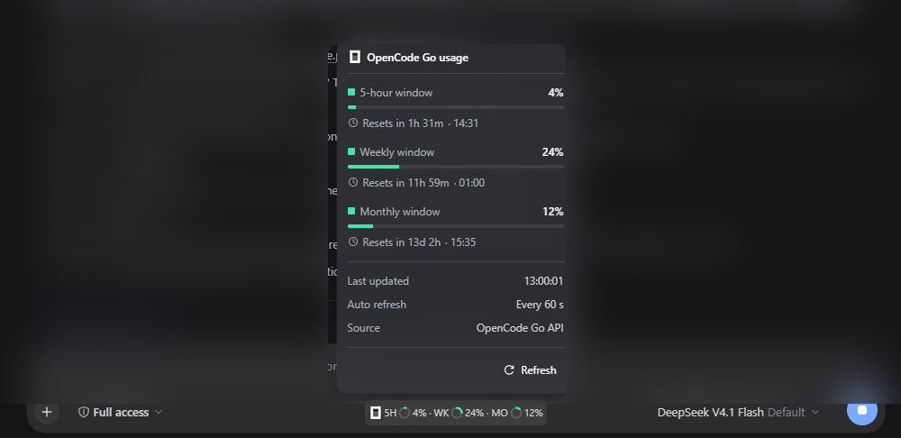

# dsh-opencodego-usage

[](https://www.npmjs.com/package/@jamolpe88/dsh-opencodego-usage)
[](https://github.com/JaMoLpE88/dsh-opencodego-usage/releases)
[](LICENSE)
[](#compatibilidad)
[](#compatibilidad)
[](https://dsh-plugin.org/plugins/jamolpe88/dsh-opencodego-usage)

**Uso de la suscripción OpenCode Go en el composer de DeepSeek Harness.** Los tramos de 5 horas, semanal y mensual viven en una píldora compacta en la fila del composer, dentro del grupo centrado de píldoras; al pulsarla se abre una ventana de detalles estilo DSH con tiempos de reset, colores y un botón de refresco manual.

Cero configuración. El plugin usa la clave del proveedor OpenCode Go que DSH ya tiene guardada: sin cookie, sin workspace ID y sin página de ajustes.

**English** → [README.md](README.md)

**Página del proyecto** → [jmolo.es/proyectos/dsh-opencodego-usage](https://jmolo.es/proyectos/dsh-opencodego-usage/)



*La ventana de detalles: un porcentaje, una barra fina y una cuenta atrás local por tramo, seguidas de última actualización, cadencia de auto-refresco, origen y refresco manual. El fondo del chat está difuminado por privacidad.*


*La píldora compacta: el logo de OpenCode y tres anillos estilo contexto separados por `·`. Se une al grupo centrado de píldoras que usan los demás plugins de JaMoLpE88 y solo aparece con un modelo de OpenCode Go; con varias píldoras visibles quedan una al lado de otra, centradas y con un pequeño margen.*

## Qué hace

- Muestra los tres tramos de OpenCode Go en una sola píldora compacta: **5 horas**, **semanal** y **mensual**.
- Usa los mismos anillos estilo contexto que el medidor de contexto de DSH, con separadores `·` entre ventanas.
- Colorea el anillo y la barra según la severidad con la misma paleta menta, ámbar y coral que el reloj de tarifas DeepSeek: menta por debajo del 50 %, ámbar del 50 % al 74 % y coral del 75 % al 100 % (un tramo limitado siempre aparece en coral).
- Abre al pulsar una ventana de detalles con aspecto nativo: porcentaje, barra fina, cuenta atrás del reset, hora local, última actualización, cadencia de auto-refresco, origen de los datos y botón **Refresh**.
- La cuenta atrás baja cada segundo mientras la ventana está abierta. Cuando un reset llega a cero, hace una lectura automática para resetear la ventana sin que el usuario haga nada.
- Refresca los porcentajes cada 60 segundos y al volver a la ventana de la aplicación.
- Solo aparece mientras el modelo activo pertenece al proveedor `opencode-go`. Con otros proveedores no muestra nada.
- Aparece también en una sesión nueva antes del primer mensaje: mientras aún no registra un modelo, la píldora sigue el modelo que muestra el compositor, incluido el predeterminado configurado.
- No necesita ajustes: la clave que ya tiene DSH es la única credencial.
- Se une al grupo centrado de píldoras compartido con los demás plugins de composer de JaMoLpE88: con varias píldoras visibles quedan una al lado de otra, centradas y con un pequeño margen, y se ocultan juntas cuando la fila se queda sin sitio.

## Qué no hace

- No lee cookies de la consola de OpenCode ni hace scraping del HTML.
- No pide una clave ni guarda una en el plugin.
- No guarda historial de uso, telemetría ni datos en el almacenamiento local.
- No añade herramientas, comandos ni cambios al agente.
- No muestra nada si el modelo activo no es de OpenCode Go.

## Por qué no hay ajustes

Si hay un modelo de OpenCode Go seleccionado, el proveedor está configurado y su clave ya está disponible para DSH. El plugin resuelve esa clave en el Host y consulta la API oficial de uso. Si no hay un modelo de OpenCode Go seleccionado, no hay nada útil que mostrar y el plugin no renderiza nada.

No hay archivo de configuración, ni campo para pegar una clave, ni editor de umbrales, ni preferencia de refresco. Es lo que es: los datos de suscripción que el proveedor ya conoce.

## Requisitos

- **DSH Desktop** `>= 0.2.1-rc.3`, perfil `desktop` (probado en `0.2.1-rc.3`, Windows 11).
- Un proveedor **OpenCode Go** configurado en **Settings → Models**, con una clave válida.
- Node 22+ (DSH trae su propio runtime).

Si el proveedor no está configurado no podrás seleccionar uno de sus modelos, así que el plugin nunca aparecerá. Es intencionado.

## Instalación

Desde npm:

```bash
dsh plugin --profile desktop add @jamolpe88/dsh-opencodego-usage
```

Desde el repositorio:

```bash
dsh plugin --profile desktop add github:JaMoLpE88/dsh-opencodego-usage
```

Desde un checkout local, mientras desarrollas:

```bash
dsh plugin --profile desktop add C:\ruta\a\dsh-opencodego-usage
```

Refresca la ventana de DSH después de instalar. La píldora aparece en el composer de cualquier sesión cuyo modelo activo use el proveedor `opencode-go`.

## Uso

1. Selecciona un modelo del proveedor **OpenCode Go**.
2. La píldora aparece en la fila del composer, dentro del grupo centrado de píldoras; las demás píldoras de JaMoLpE88 se colocan a su lado con un pequeño margen.
3. Púlsala para abrir la ventana de detalles.
4. Usa **Refresh** para una lectura inmediata; si no, el plugin se actualiza cada 60 segundos, al volver a la ventana y automáticamente cuando un reset llega a cero mientras la ventana está abierta.

Haz clic fuera de la ventana, pulsa **Escape** o vuelve a pulsar la píldora para cerrarla. Las horas de reset se muestran en la zona horaria local del navegador y las cuentas atrás se actualizan cada segundo sin hacer nada.

## Cómo funciona

La mitad Host llama al endpoint oficial de OpenCode Go con la clave del proveedor:

```http
GET https://opencode.ai/zen/go/v1/usage
Authorization: Bearer <OPENCODE_GO_API_KEY>
```

Devuelve los tres tramos:

```json
{
  "usage": {
    "rolling": { "status": "ok", "percent": 4,  "resetsAt": "2026-10-25T13:31:58.000Z" },
    "weekly":  { "status": "ok", "percent": 24, "resetsAt": "2026-10-26T00:00:00.000Z" },
    "monthly": { "status": "ok", "percent": 12, "resetsAt": "2026-11-07T14:35:16.000Z" }
  }
}
```

- La clave se resuelve desde el servicio de credenciales de DSH (`OPENCODE_GO_API_KEY`) en cada lectura; `OPENCODE_GO_API_KEY` del entorno del proceso es el fallback.
- El resultado se cachea 55 segundos para que el poll de 60 segundos y varias ventanas compartan una sola petición.
- Si falla la API, se conservan los últimos porcentajes y se marcan como **stale** en lugar de vaciar la píldora.
- La mitad navegador lee dos rutas same-origin: `/api/opencodego-usage` y `/api/opencodego-usage/refresh`. La clave nunca llega al navegador.
- La visibilidad usa la proyección viva `modelSelection`. Al cambiar a otro proveedor la píldora desaparece al instante; al volver, reaparece.
- El Client formatea las horas de reset con la zona horaria y el idioma del navegador, repinta la cuenta atrás cada segundo con la ventana abierta y fuerza una lectura nueva cuando una cuenta atrás llega a cero (con protección para que un reset no provoque un bucle de refrescos).

## Diagnóstico

Con DSH abierto, en la misma URL de la interfaz (el puerto cambia en cada arranque):

```bash
curl http://127.0.0.1:59863/api/opencodego-usage
```

Devuelve porcentajes, fechas de reset, un código de error y un indicador de frescura; nunca la clave:

```json
{
  "updatedAt": 1793016001120,
  "windows": {
    "rolling": { "percent": 4, "resetsAt": 1793025060000, "status": "ok" },
    "weekly": { "percent": 24, "resetsAt": 1793059200000, "status": "ok" },
    "monthly": { "percent": 12, "resetsAt": 1794062116000, "status": "ok" }
  },
  "error": null,
  "stale": false
}
```

Usa `/api/opencodego-usage/refresh` para saltarte la caché de 55 segundos y forzar una lectura. Cuando `error` no es `null`, `stale` indica si los porcentajes son los últimos buenos o si no hay datos.

## Compatibilidad

| | |
|---|---|
| DSH | `>= 0.2.1-rc.3` (única versión probada por el autor) |
| Node | `>= 22` |
| SO | Windows 11 (probado); macOS y Linux sin probar |
| Perfil | `desktop` |
| Proveedor | OpenCode Go configurado en **Settings → Models** |
| Grupo de píldoras | Compartido con las demás píldoras de composer de JaMoLpE88 (centradas, una al lado de otra) |
| Catálogo | [publicado en dsh-plugin.org](https://dsh-plugin.org/plugins/jamolpe88/dsh-opencodego-usage) |
| Página del proyecto | [jmolo.es/proyectos/dsh-opencodego-usage](https://jmolo.es/proyectos/dsh-opencodego-usage/) |

Estado de validación: **probado en Windows 11 con DSH Desktop 0.2.1-rc.3** (2026-10-25). La píldora aparece solo con un modelo de OpenCode Go, la ventana de detalles se abre, las horas locales y las cuentas atrás se actualizan, los colores siguen los umbrales y el refresco manual funciona. El refresco automático al llegar a cero está implementado con una guarda de un solo disparo; queda cubierto por el camino de la cuenta atrás, pero no se observó un reset real durante esta validación.

No validado: macOS, Linux, otras versiones de DSH y el perfil web.

## Límites

- **Windows 11 es la única plataforma probada.** macOS y Linux no están validados.
- **Comparte el grupo centrado de píldoras.** Cuando el composer no puede con todas las píldoras visibles, el grupo se oculta entero en lugar de solaparse con el selector de modelo.
- **Solo con OpenCode Go.** Sin ese proveedor no hay dato útil, así que el plugin no renderiza nada.
- **Sin ajustes.** No hay editor de umbrales, intervalo de refresco, preferencia de ocultación ni campo de clave.
- **Sin historial ni gráficas.** Solo los tramos actuales y sus resets.
- **Depende del endpoint de OpenCode.** Si cambia su formato, las ventanas no reconocidas se descartan y la píldora muestra un error `parse`.
- **No toca el agente.** No añade herramientas, comandos ni proveedores de modelo.

## Privacidad

- Sin cookies, sin scraping de la sesión del navegador y sin workspace ID.
- La clave de API no sale del proceso Host: el navegador solo recibe porcentajes y fechas de reset.
- Sin archivo de configuración, sin almacenamiento local, sin telemetría y sin peticiones a terceros más allá del endpoint oficial de uso.
- El Host no registra la clave ni la incluye en los mensajes de error.
- Las capturas de arriba se tomaron de una sesión real con el fondo del chat difuminado por privacidad.

Consulta [SECURITY.md](SECURITY.md) para la política resumida.

## Problemas frecuentes

**La píldora no aparece.**
Comprueba que el modelo activo pertenece al proveedor **OpenCode Go**. El plugin no renderiza nada para otros proveedores.

**La píldora muestra un punto rojo y un error.**
Abre la ventana para ver el código y la pista:

| Código | Significado |
|---|---|
| `missing-key` | DSH no tiene `OPENCODE_GO_API_KEY` para este perfil. Configura el proveedor OpenCode Go en **Settings → Models**. |
| `invalid-key` | La clave del proveedor fue rechazada (401). Revísala o sustitúyela en **Settings → Models**. |
| `no-subscription` | La clave no tiene una suscripción OpenCode Go activa (403). |
| `rate-limited` | La propia API de uso está limitando peticiones; inténtalo de nuevo en un rato. |
| `timeout` / `network` | El Host no pudo llegar a `opencode.ai`; reintenta con **Refresh**. |
| `parse` | La respuesta no traía ventanas reconocibles. |

El plugin no tiene ajustes propios: los problemas del proveedor se resuelven en los ajustes de modelos de DSH.

## Desarrollo

```bash
npm test        # node --test
npm run check   # comprobación de sintaxis del Host y el Client
```

Los tests cubren el parser de la API, el mapeo de errores HTTP, la caché, el caso de clave ausente y el fallback de datos stale. La mitad navegador es un `client.js` plano (sin build) y se verifica en el Harness en ejecución.

Instalación local:

```bash
dsh plugin --profile desktop add C:\ruta\a\dsh-opencodego-usage
```

## Marcas de terceros

OpenCode y el logo de OpenCode son marcas de sus respectivos propietarios. El logo se usa solo para identificar el servicio OpenCode Go; no está cubierto por la licencia MIT que se aplica al código. Ver [NOTICE](NOTICE).

## Licencia

[MIT](LICENSE) © 2026 JaMoLpE88
